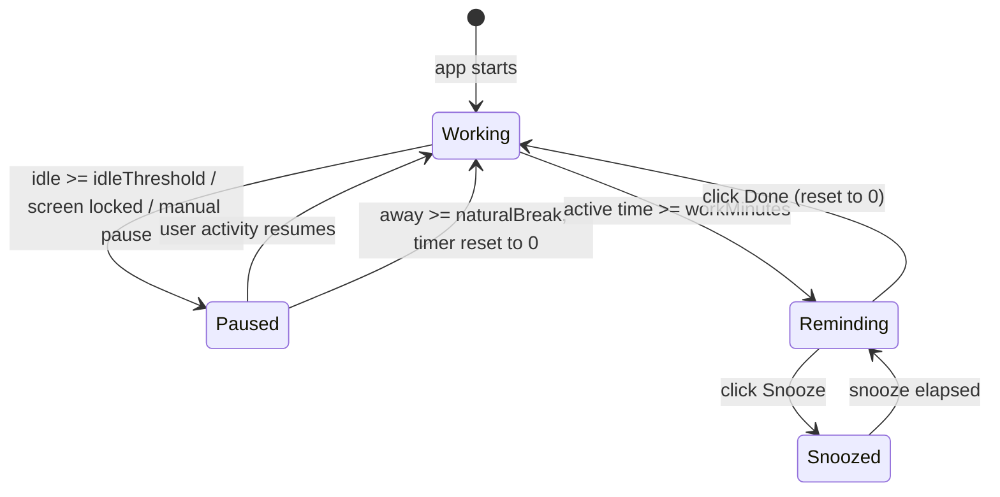
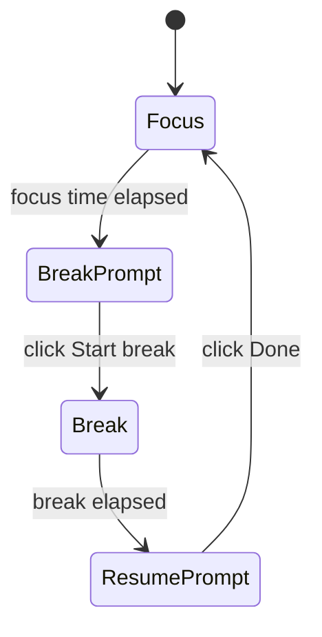

# BreakBuddy — Product & Technical Specification

> Audience: coding agents and developers implementing the app.
> Platforms: Windows 10/11, macOS 12+. Spec version: 1.0

## 1. Summary

BreakBuddy is a lightweight desktop app that runs in the background, starts automatically with the OS, and tracks **active computer usage time**. After **20 minutes** of active use it shows a small, friendly reminder card in a **screen corner** and **waits until the user clicks "Done"**. Clicking "Done" resets the timer to 0 and counting restarts. An optional **Pomodoro mode** is available.

### Goals

- Automatic: install once, no further setup required.
- Easy: one primary button to acknowledge a reminder.
- Friendly and non-intrusive: never steals keyboard focus, never covers the main work area.
- Light: low RAM, near-zero CPU while waiting.
- Private: measures idle time only; never logs keystrokes, screen content, or app usage.

### Non-goals (v1)

Cloud sync, accounts, mobile apps, calendar integration, blocking apps/websites.

## 2. Tech Stack

| Layer | Choice | Notes |
|---|---|---|
| App framework | **Tauri 2** (Rust) | Small bundle, low RAM, good for always-on apps |
| UI | **React + TypeScript + Vite** | |
| Styling / animation | **Tailwind CSS**, **Framer Motion** | Smooth popup enter/exit |
| UI state | **Zustand** | |
| Idle detection | Rust crate `user-idle`, or native calls: `GetLastInputInfo` (Windows), `CGEventSourceSecondsSinceLastEventType` (macOS) | Reads OS idle seconds only. No input hooks. |
| Popup window | Tauri secondary window | `always_on_top`, `decorations:false`, `transparent:true`, `skip_taskbar:true`, `focus:false`, `resizable:false`, `shadow:false` |
| System tray | Tauri tray API | Status icon + menu |
| Autostart | `tauri-plugin-autostart` | |
| Settings storage | `tauri-plugin-store` (JSON) | |
| Stats storage | SQLite via `tauri-plugin-sql` | |
| Sound | HTML `<audio>` in webview | Short soft chime |
| Updates | `tauri-plugin-updater` | Optional in v1.1 |
| Packaging | Tauri bundler | `.msi`/`.exe`, `.dmg` |

**Fallback stack** (only if Rust is not acceptable): Electron + React + TypeScript, using `powerMonitor.getSystemIdleTime()` for idle detection and a frameless `BrowserWindow` with `alwaysOnTop`, `focusable:false`, `skipTaskbar:true`. All logic and UI below still apply.

## 3. Architecture

```
┌──────────────────────────── Tauri App ────────────────────────────┐
│ Rust core (always running, owns ALL timing logic)                 │
│   ├─ IdleWatcher    polls OS idle seconds every 1s                │
│   ├─ TimerEngine    state machine (see §5)                        │
│   ├─ WindowManager  shows/hides popup on the correct monitor      │
│   ├─ TrayManager    tray icon, tooltip, menu                      │
│   └─ Storage        settings (JSON) + stats (SQLite)              │
│            ▲  events / commands (IPC)  ▼                          │
│ Frontend (React, in webviews)                                     │
│   ├─ Popup window     reminder card + Done button                 │
│   ├─ Settings window                                              │
│   └─ Stats window                                                 │
└───────────────────────────────────────────────────────────────────┘
```

**Rules**

1. The timer lives in Rust, not in the frontend. It must keep working when no window is open.
2. Use a **monotonic clock** (`std::time::Instant`), never wall-clock time, to avoid errors from sleep/wake or system clock changes.
3. Only one popup may exist at a time.

### Suggested project layout

```
breakbuddy/
├─ src-tauri/
│  ├─ src/
│  │  ├─ main.rs
│  │  ├─ idle.rs          # IdleWatcher
│  │  ├─ engine.rs        # TimerEngine + state machine
│  │  ├─ windows.rs       # popup placement / show / hide
│  │  ├─ tray.rs
│  │  ├─ settings.rs
│  │  └─ stats.rs
│  ├─ tauri.conf.json
│  └─ Cargo.toml
├─ src/
│  ├─ popup/              # reminder card UI
│  ├─ settings/
│  ├─ stats/
│  ├─ store.ts            # Zustand
│  ├─ i18n/               # en.json, vi.json
│  └─ main.tsx
└─ package.json
```

## 4. Functional Requirements

### 4.1 Active-time timer (core)

| ID | Requirement |
|---|---|
| F1 | Timer starts automatically when the app launches. |
| F2 | Timer counts only while the user is **actively using** the computer (OS idle time < `idleThresholdSec`). |
| F3 | Timer **pauses** when idle ≥ `idleThresholdSec` (default 120s), when the screen is locked, or when the system sleeps. |
| F4 | If the user is away ≥ `naturalBreakSec` (default 300s), treat it as a natural break and **reset the timer to 0**. |
| F5 | When active time reaches `workMinutes` (default 20), transition to `Reminding` and show the popup. |

### 4.2 Reminder popup

| ID | Requirement |
|---|---|
| P1 | Appears in a screen corner (default bottom-right; configurable to any of 4 corners), inside the monitor work area with ~16px margin. |
| P2 | Always on top, borderless, rounded, **does not take keyboard focus**, not shown in taskbar/Dock/Alt-Tab. |
| P3 | Shows a friendly message, a rotating break suggestion, and subtle animation. |
| P4 | Primary button **"Done"**. The popup **never auto-dismisses**; it stays until Done (or Snooze) is clicked. |
| P5 | Clicking Done: hide popup, **reset timer to 0**, return to `Working`. |
| P6 | Optional secondary button **"Remind me in 5 min"** (setting `snoozeEnabled`). |
| P7 | If not acknowledged after 2 minutes, play a soft sound and/or do a single gentle shake animation. Repeat at most every 5 minutes. |
| P8 | Multi-monitor: show on the monitor containing the mouse cursor. |
| P9 | Optional "Do not disturb": suppress popup while a fullscreen app or screen sharing is active, and show it as soon as that ends. |
| P10 | Keyboard shortcut: `Enter` (when popup hovered) or global shortcut `Ctrl/Cmd+Shift+B` = Done. |

### 4.3 Pomodoro mode (optional)

Setting `mode` is `"reminder"` (default) or `"pomodoro"`.

Pomodoro behavior:

- Focus: `focus` minutes (default 25) → popup "Time for a break" with button **"Start break"**.
- Break: `short` minutes (default 5) countdown; after `cycles` focus sessions (default 4), use `long` (default 15).
- When break ends: popup "Back to work" with button **"Done"**, which starts the next focus session.
- Every transition waits for a user click (consistent with the core "wait for confirmation" rule).
- Popup shows a progress ring and cycle indicator, e.g. 🍅🍅🍅⚪.
- Optional preset **20-20-20**: every 20 minutes, look at something ~6 m away for 20 seconds.

### 4.4 System tray

- Icon reflects state: counting / paused / reminding.
- Tooltip shows time remaining until next reminder.
- Menu: Pause 30 min · Pause 1 hour · Pause until tomorrow · Resume · Settings · Stats · Quit.

### 4.5 Settings

| Key | Default | Description |
|---|---|---|
| `mode` | `"reminder"` | `reminder` or `pomodoro` |
| `workMinutes` | `20` | Active minutes before reminder |
| `idleThresholdSec` | `120` | Idle seconds before timer pauses |
| `naturalBreakSec` | `300` | Away seconds that count as a break and reset timer |
| `popupCorner` | `"bottom-right"` | `top-left`, `top-right`, `bottom-left`, `bottom-right` |
| `sound` | `true` | Play chime on reminder |
| `snoozeEnabled` | `true` | Show "Remind me in 5 min" |
| `snoozeMinutes` | `5` | |
| `pomodoro` | `{focus:25, short:5, long:15, cycles:4}` | |
| `autostart` | `true` | Launch at login |
| `theme` | `"system"` | `light`, `dark`, `system` |
| `language` | `"en"` | `en` or `vi` |
| `workHours` | `null` | e.g. `{start:"09:00", end:"18:00"}`; reminders only inside this window |
| `doNotDisturbFullscreen` | `true` | Defer popup during fullscreen / screen share |

Changes apply immediately (no Save button).

### 4.6 Stats (simple)

Per day: number of reminders, number of Done clicks, total active time, completed Pomodoro cycles, and a consecutive-days streak of taking breaks. Show today's card and a 7-day bar chart.

## 5. State Machine

### 5.1 Reminder mode



### 5.2 Pomodoro mode



### 5.3 Engine pseudocode

```text
every 1s:
  idle = os_idle_seconds()
  if state == Working:
      if idle >= naturalBreakSec:      active = 0            # natural break
      elif idle >= idleThresholdSec:   state = Paused
      else:                            active += 1
      if active >= workMinutes*60:     state = Reminding; show_popup()
  elif state == Paused:
      if idle < idleThresholdSec:      state = Working       # resume (reset if away long enough)
  elif state == Reminding:
      # do nothing; wait for complete_break() or snooze()
      # if popup unacknowledged > 120s: nudge (sound/shake), rate-limited
```

Edge cases:

- **Sleep/wake:** treat the sleep duration as away time and apply F4.
- **User leaves while popup is showing:** popup stays. Optional setting: if idle ≥ `naturalBreakSec` while Reminding, auto-close popup, count it as a break, reset timer.
- **Manual pause from tray:** timer frozen; resumes automatically when pause expires.
- **App restart:** timer starts from 0.

## 6. IPC Contract (Rust ⇄ Frontend)

**Events (Rust → frontend)**

| Event | Payload | Purpose |
|---|---|---|
| `timer:tick` | `{ state, activeSec, remainingSec }` | Tooltip and progress UI |
| `timer:remind` | `{ kind: "work"\|"break"\|"resume", tip: string }` | Show/update popup content |
| `settings:changed` | full settings object | Keep UI in sync |

**Commands (frontend → Rust)**

| Command | Args | Effect |
|---|---|---|
| `complete_break` | none | Hide popup, reset timer, state = Working |
| `start_break` | none | Pomodoro: begin break countdown |
| `snooze` | `minutes: number` | Hide popup, re-remind later |
| `pause` | `minutes: number \| "today"` | Manual pause |
| `resume` | none | Clear manual pause |
| `get_settings` / `update_settings` | settings patch | Read / persist settings |
| `get_stats` | `range: "today"\|"7d"` | Stats data |

## 7. Data Model

Settings JSON example:

```json
{
  "mode": "reminder",
  "workMinutes": 20,
  "idleThresholdSec": 120,
  "naturalBreakSec": 300,
  "popupCorner": "bottom-right",
  "sound": true,
  "snoozeEnabled": true,
  "snoozeMinutes": 5,
  "pomodoro": { "focus": 25, "short": 5, "long": 15, "cycles": 4 },
  "autostart": true,
  "theme": "system",
  "language": "en",
  "workHours": null,
  "doNotDisturbFullscreen": true
}
```

SQLite:

```sql
CREATE TABLE sessions (
  id            INTEGER PRIMARY KEY AUTOINCREMENT,
  started_at    TEXT NOT NULL,      -- ISO 8601
  active_secs   INTEGER NOT NULL,
  reminded_at   TEXT,
  completed_at  TEXT,               -- NULL if never acknowledged
  mode          TEXT NOT NULL       -- 'reminder' | 'pomodoro'
);
CREATE INDEX idx_sessions_started ON sessions(started_at);
```

## 8. UI / UX Spec

### Reminder popup (~320 × 160 px)

- Rounded corners (16px), soft shadow, calm pastel palette (green/teal), light and dark variants.
- Small illustration or mascot (e.g. a stretching cat) with a gentle animation.
- Title: "You've been at it for 20 minutes 👀"
- Rotating suggestions: "Look away for 20 seconds", "Stand up and stretch", "Have a sip of water", "Roll your shoulders".
- Large primary button **Done ✓**; small text button "Remind me in 5 min".
- Enter: fade + slide-in (~250 ms). Exit: fade-out. No flashing or jarring motion.
- Pomodoro: progress ring + cycle dots.
- Accessibility: WCAG AA contrast, readable font size (≥ 14px), button reachable via keyboard.

### Settings window

Sections: General · Reminders · Pomodoro · Appearance. Instant apply.

### Stats window

Today summary cards, 7-day bar chart, streak counter.

## 9. Non-Functional Requirements

- **Performance:** background RAM < ~80 MB; CPU ≈ 0% while counting; 1 Hz idle polling.
- **Size:** installer < ~15 MB with Tauri.
- **Reliability:** correct after sleep/wake, timezone and system clock changes (monotonic clock).
- **Privacy:** only OS idle seconds are read. No keylogging, no screenshots, no app/window titles, no network calls in v1. Data stays local.
- **i18n:** all UI strings in `src/i18n/*.json`; English default, Vietnamese included.
- **Security:** minimal Tauri capabilities/permissions; no remote content loaded in webviews.

## 10. Implementation Plan (ordered tasks for agents)

**Milestone 1 — MVP**

1. Scaffold Tauri 2 + React + TS + Tailwind project.
2. Implement `IdleWatcher` (cross-platform OS idle seconds).
3. Implement `TimerEngine` with states Working / Paused / Reminding and unit tests using a fake clock.
4. Create popup window (frameless, transparent, always-on-top, no focus); position in configured corner on cursor's monitor.
5. Build popup UI with Done button wired to `complete_break`.
6. Add system tray with state icon, tooltip, pause/resume/quit.
7. Add autostart.

**Milestone 2 — v1.0**

8. Settings store + settings window.
9. Snooze, sound, nudge-after-2-minutes behavior.
10. Pomodoro mode (§4.3, §5.2).
11. Light/dark theme, animations, i18n (en/vi).
12. Fullscreen / screen-share do-not-disturb, work-hours window.

**Milestone 3 — v1.1**

13. SQLite stats + stats window + streak.
14. Auto-updater, signed installers for Windows and macOS.

## 11. Acceptance Criteria (MVP)

- [ ] App launches at login and lives in the system tray.
- [ ] After 20 minutes of real activity, a popup appears in the configured screen corner.
- [ ] Popup does not steal keyboard focus and never auto-dismisses.
- [ ] Clicking **Done** hides the popup, resets the timer to 0, and counting restarts.
- [ ] Timer does not advance while the user is idle ≥ 2 min, the screen is locked, or the machine sleeps.
- [ ] Being away ≥ 5 min resets the timer.
- [ ] Only one popup can be visible at a time; works on multi-monitor setups.
- [ ] Idle RAM < ~80 MB and no noticeable CPU use over an 8-hour run.
- [ ] Unit tests cover all state transitions in §5.1 and the edge cases in §5.3.

## 12. Risks & Notes

| Risk | Mitigation |
|---|---|
| Popup steals focus while the user types | Create window with `focus:false`; accept mouse clicks only. |
| Popup hidden behind fullscreen apps | Detect fullscreen and defer, or fall back to a native OS notification. |
| Clock drift after sleep | Monotonic clock; reconcile using OS idle time on wake. |
| macOS input permissions | `CGEventSourceSecondsSinceLastEventType` needs no Accessibility permission; prefer it over event taps. |
| Annoyance if user is mid-task | Snooze button, pause from tray, work-hours window. |
